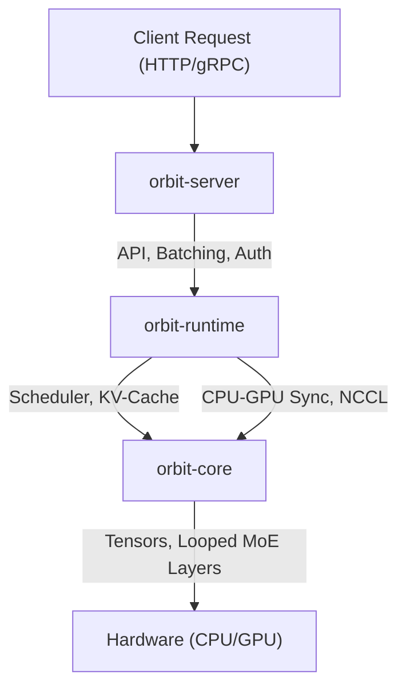

# 🌌 Orbit Engine

**Tagline:** *Loop the Future. Compute only what matters. Scale beyond boundaries.*

**Status:** Pre-Alpha / Architectural Design  
**Language:** Rust (Powered by Hugging Face `candle`)  
**Target Architecture:** Looped Mixture-of-Experts (Looped MoE)

---

## 1. Abstract

The rapid scaling of Large Language Models (LLMs) has led to unsustainable inference costs. **Orbit** is a next-generation, memory-safe LLM inference engine built in Rust, designed specifically for **Looped Mixture-of-Experts (Looped MoE)** architectures. 

Unlike traditional engines that treat LLMs as static dense models, Orbit embraces the orthogonal scaling axes of **Recurrence** (looping shared layers for effective depth) and **Sparsity** (activating only relevant experts for parameter capacity). By combining Rust's fearless concurrency with intelligent CPU-GPU orchestration, Orbit delivers enterprise-grade throughput, low latency, and zero-copy memory management on any hardware—from edge devices to multi-GPU clusters.

---

## 2. The Orbit Philosophy (10 Pillars)

Orbit is not just a software project; it is an architectural philosophy guided by ten core pillars:

1. **Recurrence over Width:** Loop the parameters, don't just stack them. Maximize effective depth with minimal VRAM.
2. **Sparsity by Default:** Compute only what matters. Per-loop routers ensure zero FLOPs on irrelevant weights.
3. **Memory is Sacred:** Fearless concurrency and zero garbage collection overhead. Paged KV-cache ensures no fragmentation.
4. **Micro-kernel Architecture:** Separation of concerns between Core (math), Runtime (memory/scheduling), and Server (API).
5. **CPU-GPU Synergy:** *"Compute on GPU, Park on CPU."* Asynchronous offloading of inactive experts to CPU RAM to run massive MoE models on consumer GPUs.
6. **Distributed Orbit:** Expert Parallelism by default. Route tokens seamlessly across multiple GPUs (NVLink/PCIe) without bottlenecking.
7. **Intelligent Scheduling:** Continuous Batching (in-flight requests) and Prefill-Decode Disaggregation for maximum hardware utilization.
8. **Zero-Redundancy Caching:** RadixAttention and Prefix Caching to reuse shared KV-caches, drastically reducing prefill times for agentic workflows.
9. **Lossless Acceleration:** Speculative Decoding to verify multiple generated tokens in a single forward pass.
10. **Enterprise-Ready & Edge-Native:** Multi-tenancy isolation, RBAC/SSO security, and a lightweight profile for offline edge deployment.

---

## 3. The Orbit Manifesto (20 Rules of Design)

**Architecture & Computation:**
1. Recurrence over Width.
2. Iteration is Identity (IterAdaLN).
3. Sparsity by Default (Top-K Routing).
4. Compute only what matters.
5. Quantize with Precision (FP8/INT8 support).
6. Speculate to Accelerate (Speculative Decoding).

**Systems & Hardware:**
7. Rust is King (No segfaults).
8. Memory is Sacred (PagedAttention).
9. Overlap Compute and Communication (Async prefetching).
10. Expert Locality (Minimize cross-GPU traffic).
11. Graceful Degradation (Crash-resistant fallbacks).
12. Run at the Edge (Offline-first).

**Scheduling & Serving:**
13. Async Everywhere (Continuous batching).
14. Disaggregate Prefill and Decode.
15. Cache is King (Radix/Prefix caching).
16. Structure the Output (JSON/Regex native support).

**Security & Observability:**
17. Fail Fast, Recover Faster (Expert collapse detection).
18. Isolate Tenants by Default.
19. Observability is Built-in (Prometheus/OpenTelemetry).
20. Authenticate at the Gateway (SSO/RBAC).

---

## 4. System Architecture

Orbit is structured as a Cargo Workspace with three highly decoupled crates:

